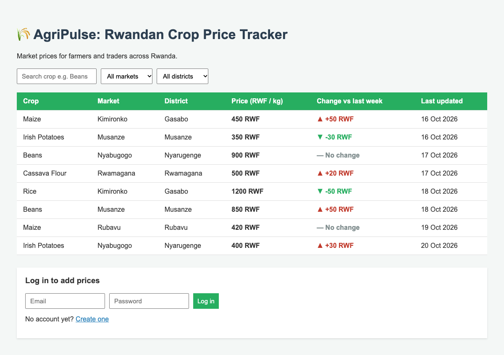
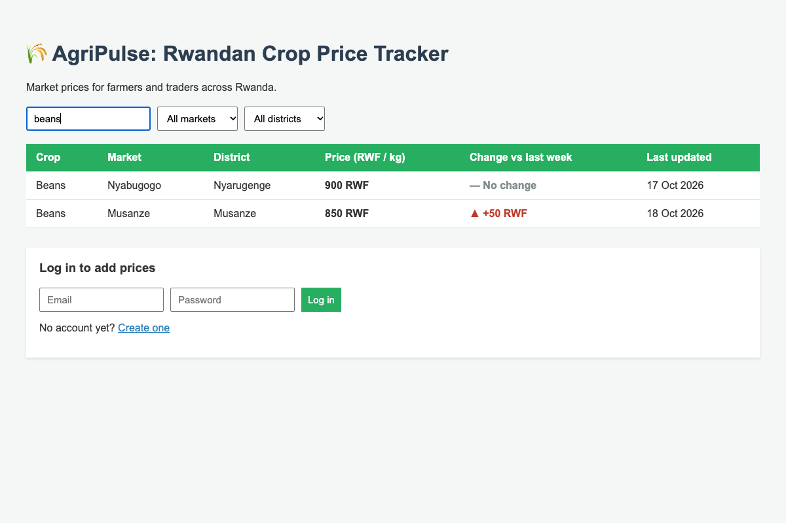
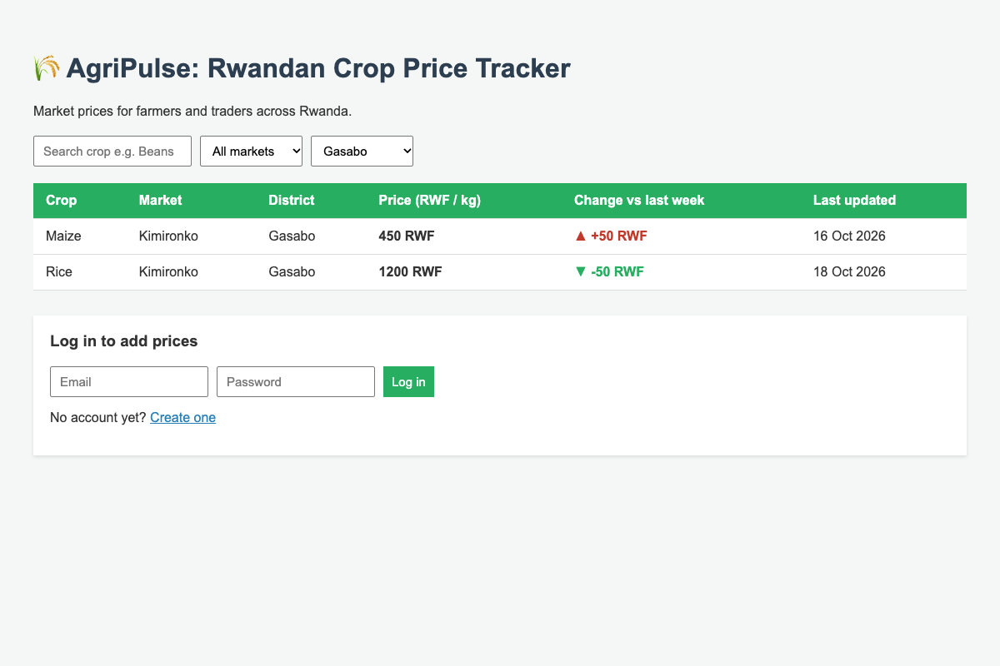
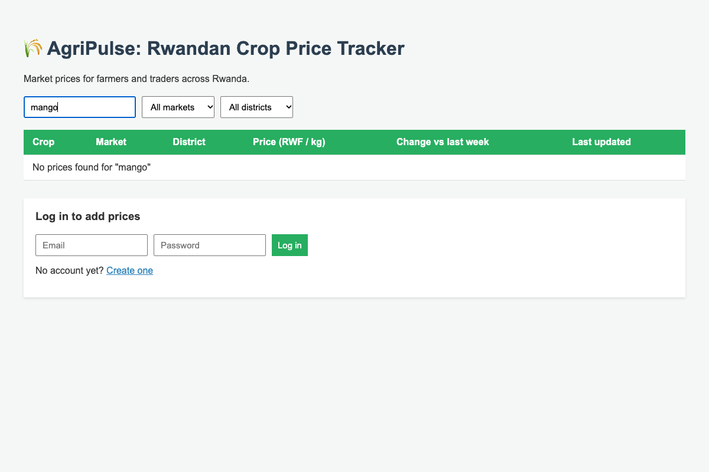
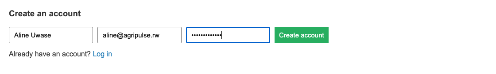
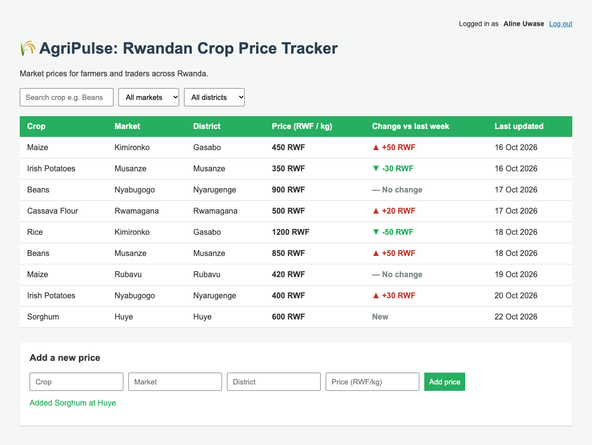
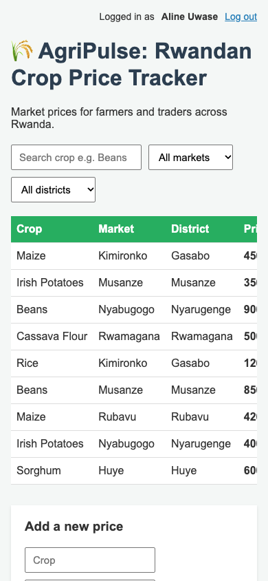

# 🌾 AgriPulse: Rwandan Crop Price Tracker

[](https://github.com/fistonfle/agripulse-crop-price-tracker/actions/workflows/ci.yml)

> Empowering farmers, traders, and cooperatives with market price transparency.

## Problem Statement

Smallholder farmers and local traders in Rwanda often lack access to timely, accurate market price data across different trading hubs. This leaves them vulnerable to exploitative middlemen and makes it hard to decide when and where to sell their produce for a fair price.

## Team Members

| Name | Role | Email |
| ---- | ---- | ----- |
| Nshimiyandinze Fiston | Software Engineer | n.fiston@alustudent.com |
| Aluel Tabitha Kuir | Software Engineer | t.kuir@alustudent.com |

## Target Users

- **Smallholder farmers** — find the best local market to sell their harvest
- **Traders & cooperatives** — monitor price trends across regions to plan purchases
- **Consumers / retail buyers** — track food price changes

## Core Features

1. **Price feed** — view current prices for staples (Maize, Beans, Irish Potatoes, Rice) across markets like Kimironko, Musanze, Nyabugogo and Rubavu
2. **Search & filter** — filter prices by crop name, market or district
3. **Price comparison** — see how each price changed since last week (▲ up / ▼ down)
4. **Add new prices** — market collectors submit new prices through a form
5. **Accounts** — register and log in; only logged-in users can add prices, and each price shows who added it

## Screenshots

### Price feed
All crop prices with the change since last week and the date of each price. Anyone can view it, no login needed.



### Search by crop
Typing a crop name filters the table instantly (extra spaces are ignored).



### Filter by district
Pick a market or district to see only the prices there.



### No results
A clear message when nothing matches the search.



### Create an account
Market collectors register with a name, email and password (at least 8 characters).



### Logged in: add a new price
After logging in, the "Add a new price" form appears. New prices are saved in the database and show as **New** until there is history for them.



### On a phone
The page adapts to small screens, and the table scrolls sideways.



## Technology Stack

| Layer | Technology |
| ----- | ---------- |
| Frontend | React 19, Vite |
| Backend | Node.js, Express 5 (REST API) |
| Database | PostgreSQL 16 (Docker Compose), `pg` library |
| Auth | JWT (`jsonwebtoken`), passwords hashed with `bcryptjs` |
| Testing | Jest + Supertest (backend), Vitest + React Testing Library (frontend) |
| Linting | ESLint |
| CI | GitHub Actions |
| Version control | Git & GitHub |

## Project Structure

```
agripulse-crop-price-tracker/
├── .github/workflows/
│   └── ci.yml              # CI: lint, test, build on PRs
├── docker-compose.yml      # PostgreSQL database
├── docs/screenshots/       # Images used in this README
├── backend/                # Express REST API
│   ├── db/                 # schema.sql (tables), seed.sql (sample data)
│   ├── .env.example        # Settings (copy to .env)
│   ├── src/
│   │   ├── app.js          # API routes
│   │   ├── auth.js         # Register, login, JWT check
│   │   ├── db.js           # PostgreSQL connection
│   │   ├── data.js         # Database queries for prices
│   │   └── server.js       # Starts the API on port 3000
│   ├── tests/
│   │   ├── app.test.js     # API tests
│   │   ├── addPrice.test.js # Add price tests
│   │   └── priceChange.test.js # Price comparison tests
│   └── package.json
├── frontend/               # React + Vite app
│   ├── src/
│   │   ├── App.jsx         # Main page: search, filter, table
│   │   ├── App.test.jsx    # UI tests
│   │   ├── components/
│   │   │   ├── PriceTable.jsx
│   │   │   ├── AuthForm.jsx
│   │   │   ├── PriceChange.jsx
│   │   │   └── AddPriceForm.jsx
│   │   └── main.jsx
│   ├── vite.config.js      # Proxies /api to the backend
│   └── package.json
└── README.md
```

## Getting Started

### Prerequisites

- **Git**: [git-scm.com/downloads](https://git-scm.com/downloads)
- **Docker Desktop** (runs the database): [docker.com/products/docker-desktop](https://www.docker.com/products/docker-desktop/)
- **Node.js 20 or newer** (npm comes with it): download the **LTS** version from [nodejs.org](https://nodejs.org/)
  - **Windows**: run the `.msi` installer and keep the default options
  - **macOS**: run the `.pkg` installer, or use Homebrew: `brew install node`

After installing, open a **new** terminal and check the versions:

```bash
node -v    # should print v20 or higher
npm -v
git --version
```

On Windows, use **PowerShell** or **Git Bash**. On macOS, use **Terminal**.

### Run locally

You need **two terminals**: one for the backend, one for the frontend.

```bash
git clone https://github.com/fistonfle/agripulse-crop-price-tracker.git
cd agripulse-crop-price-tracker
```

**Step 1: start the database** (once; it keeps running in the background)

```bash
docker compose up -d
```

This starts PostgreSQL on port **5433** and creates two databases: `agripulse` (the app) and `agripulse_test` (automated tests).

**Terminal 1: backend (API)**

```bash
cd backend
npm install
cp .env.example .env      # Windows: copy .env.example .env
npm run db:setup          # creates the tables and loads sample prices
npm run dev
```

`npm run db:setup` deletes all data and starts fresh. Run it the first time, or when you want to reset.

The API runs at http://localhost:3000.

**Terminal 2: frontend (React)**

```bash
cd frontend
npm install
npm run dev
```

Open http://localhost:5173 in your browser. Vite forwards `/api` requests to the backend.

To check that the backend is running, open http://localhost:3000/health. You should see `{"status":"ok","database":"ok"}`.

To stop the database: `docker compose down` (your data is kept). To delete the data too: `docker compose down -v`.

To stop either app, press `Ctrl + C` in its terminal.

### Run lint and tests

The backend tests need the database running (`docker compose up -d`). They use the separate `agripulse_test` database, so your app data is safe.

```bash
cd backend && npm run lint && npm test
cd ../frontend && npm run lint && npm test
```

The same checks run automatically on every pull request through GitHub Actions ([ci.yml](.github/workflows/ci.yml)).

### Common problems

| Problem | Fix |
| ------- | --- |
| `node` or `npm` is not recognized | Node.js isn't installed, or the terminal was open during the install. Install Node.js LTS, then close and reopen the terminal. |
| `npm error enoent ... package.json` | You're in the wrong folder. Run npm commands inside `backend/` or `frontend/`, not the project root. |
| `EADDRINUSE: address already in use :::3000` | Another program is using port 3000 (often an old backend still running). Close it with `Ctrl + C` in that terminal. Or find it: `lsof -i :3000` (macOS) / `netstat -ano \| findstr :3000` (Windows). |
| Vite starts on port 5174 instead of 5173 | Port 5173 is busy. That's fine, just open the URL Vite prints. |
| Page shows "Could not load prices. Is the backend running?" | The backend isn't running. Start it in Terminal 1 (`cd backend && npm run dev`) and refresh the page. |
| Health shows `"database":"unreachable"` or `ECONNREFUSED ...:5433` | The database isn't running. Start Docker Desktop, then run `docker compose up -d` in the project root. |
| `relation "prices" does not exist` | The tables weren't created yet. Run `npm run db:setup` in `backend/`. |
| "Please log in first" or you get logged out | Your login token is missing or expired (after 7 days). Log in again. |
| `JWT_SECRET is not set` | Copy `backend/.env.example` to `backend/.env`. |
| `Cannot find module ...` | Dependencies aren't installed. Run `npm install` in that folder. |
| Changes don't show up | The frontend reloads automatically. For the backend, `npm run dev` restarts on save. If you used `npm start`, stop it and run again. |

## API Endpoints

| Method | Endpoint | Description |
| ------ | -------- | ----------- |
| GET | `/api/prices` | All prices as JSON, with `lastWeekPrice` and `change`. Optional `?market=`, `?district=` and `?crop=` |
| POST | `/api/prices` | Add a price (**login required**). JSON body: `{ crop, market, district, pricePerKg }` |
| GET | `/api/prices/:id` | A single price entry |
| GET | `/api/prices/:id/history` | Past prices for an entry, oldest first |
| GET | `/api/markets` | List of markets |
| GET | `/api/districts` | List of districts |
| POST | `/api/auth/register` | Create an account. JSON body: `{ name, email, password }` (min 8 characters). Returns `{ user, token }` |
| POST | `/api/auth/login` | Log in. JSON body: `{ email, password }`. Returns `{ user, token }` |
| GET | `/api/auth/me` | The logged-in user (**login required**) |
| GET | `/health` | Health check (also checks the database) |

**Login required** means sending the token from register/login in a header: `Authorization: Bearer <token>`. Tokens last 7 days.

## Project Board

Our backlog is tracked on the GitHub Projects board: [AgriPulse Board](https://github.com/users/fistonfle/projects/4/views/1)

## License

This project is licensed under the MIT License — see [LICENSE](./LICENSE).
